---

 

  
---

-  Name : Kim JeongUn
-  Birth Date : 2002/09/11
-  Nation : Republic of Korea(ROK)
-  Major : Statistics & Computer Science - DA
-  Email : rlawjddns02@gmail.com
-  School : Yeungnam Univ.
-  Interest : Retrieval-Augmented Generatiuon(RAG) Research/Study
-  Portfolio : <a href="https://daffy-bestseller-00c.notion.site/Kim-Jeong-Un-s-Portfolio-30b625d0c5ce80ea964fd011d708ae12?pvs=74">**Vni Portfolio Notion Pages**</a>

## Stack
- FrontEnd
  
   
   
- Data Analysis

      

  
  

<picture>
  <source media="(prefers-color-scheme: dark)" srcset="./assets/rhythm.dark.svg" />
  
</picture>
